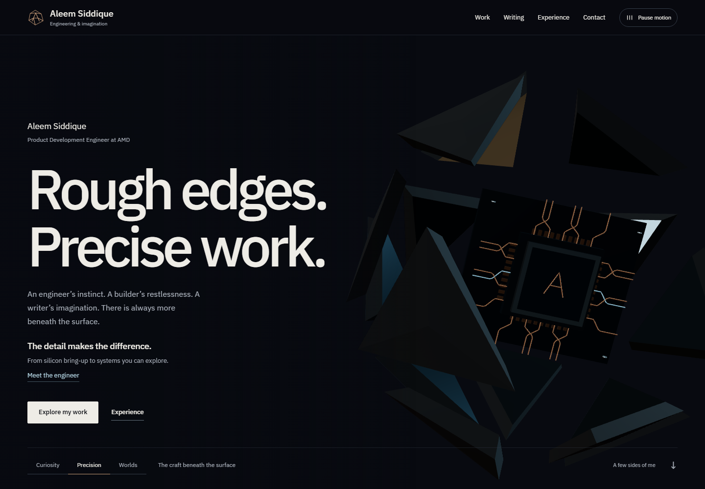
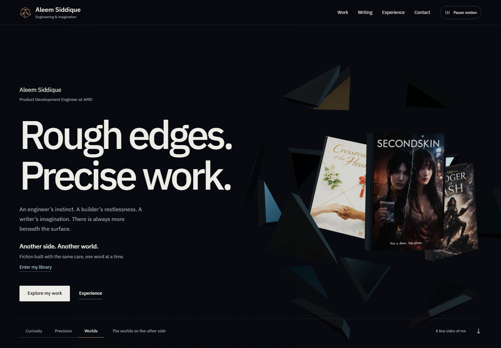
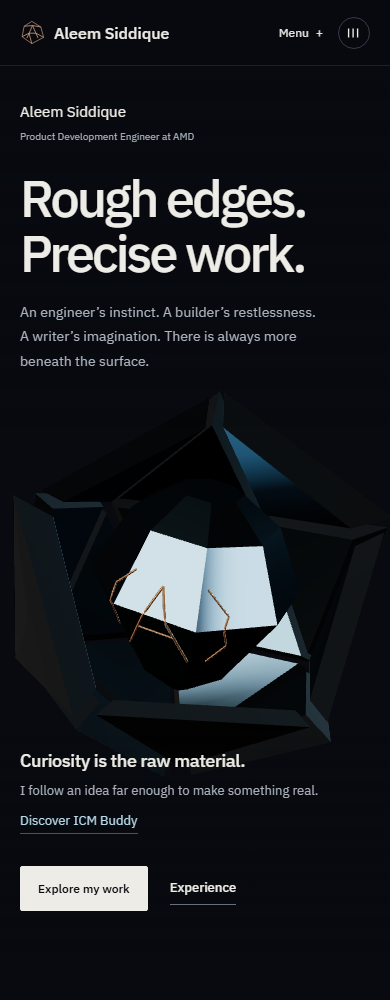
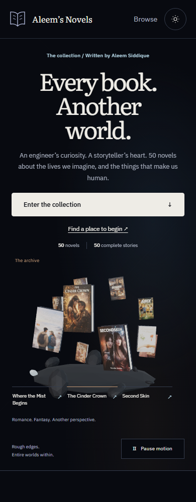
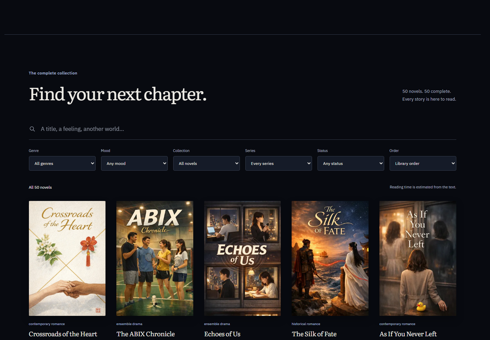
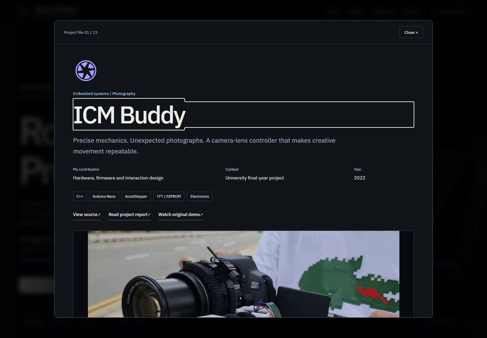

# Production review images

Captured from the combined production build at `http://127.0.0.1:4176`, with real interactive geometry and the author's existing cover artwork. [manifest.json](manifest.json) records each viewport and page. Regenerate with `node showcase/scripts/capture-facets.mjs` while the comparison is running.

## Portfolio

## Novel collection

## Project details

